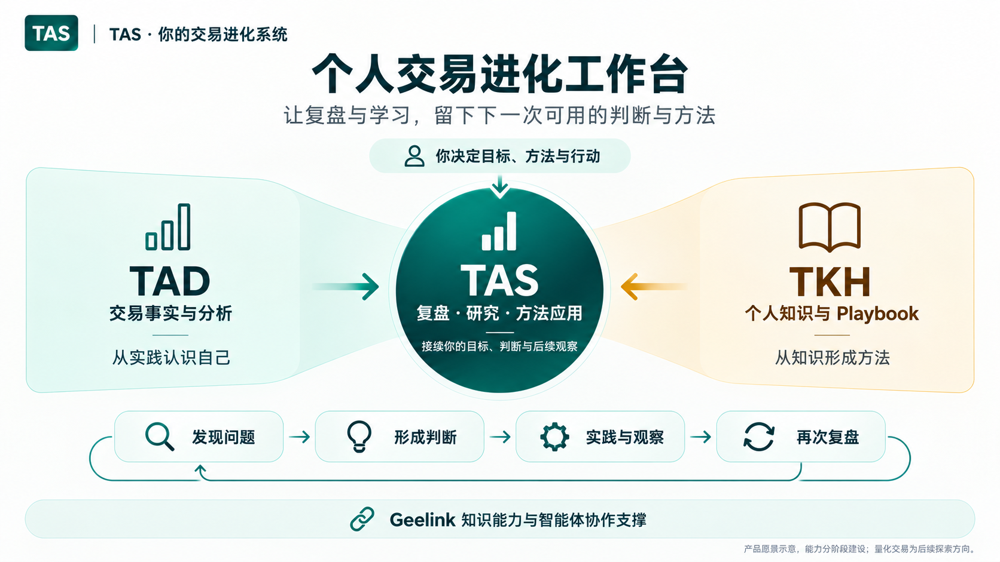

# Trading Alpha System（TAS）

[English](https://github.com/TradingAlphaSystem)

**你的交易进化系统。**

看清自己的交易，形成自己的方法，让下一次实践接续上一次的认识。

TAS 是面向股票与期权投资者、正在开发中的个人交易进化工作台，以智能体协作为核心，连接交易分析、知识学习与方法应用。它旨在围绕你自己的交易记录、学习目标和判断，组织能够保存、再次打开和持续跟进的复盘与研究。

如果你的券商记录、交易教育视频、文章和笔记还彼此分散，TAS 希望帮助你将它们连接起来，让一次复盘留下下一次可用的成果。

**[参与共创](https://github.com/TradingAlphaSystem/.github/issues/new?title=%5B%E5%85%B1%E5%88%9B%E6%8A%A5%E5%90%8D%5D%20%E8%87%AA%E6%88%91%E4%BB%8B%E7%BB%8D&body=%E5%8F%82%E4%B8%8E%E6%96%B9%E5%90%91%EF%BC%9A%E4%BA%A4%E6%98%93%E4%B8%93%E5%AE%B6%20%2F%20%E5%BC%80%E5%8F%91%E8%80%85%20%2F%20%E4%B8%A4%E8%80%85%E5%85%BC%E6%9C%89%0A%0A%E7%9B%B8%E5%85%B3%E7%BB%8F%E9%AA%8C%EF%BC%9A%0A%0A%E5%B8%8C%E6%9C%9B%E5%8F%82%E4%B8%8E%E5%BB%BA%E8%AE%BE%E6%88%96%E9%AA%8C%E8%AF%81%E7%9A%84%E5%86%85%E5%AE%B9%EF%BC%9A%0A%0A%E8%BF%99%E6%98%AF%E5%85%AC%E5%BC%80%20Issue%E3%80%82%E8%AF%B7%E5%8B%BF%E5%A1%AB%E5%86%99%E8%B4%A6%E6%88%B7%E8%B5%84%E6%96%99%E3%80%81%E4%BA%A4%E6%98%93%E5%AF%B9%E8%B4%A6%E5%8D%95%E3%80%81%E7%A7%81%E4%BA%BA%E7%AD%96%E7%95%A5%E6%88%96%E7%A7%81%E4%BA%BA%E8%81%94%E7%B3%BB%E6%96%B9%E5%BC%8F%E3%80%82%E6%88%91%E4%BB%AC%E5%8F%AF%E4%BB%A5%E9%80%9A%E8%BF%87%E8%BF%99%E4%B8%AA%20GitHub%20%E8%AE%A8%E8%AE%BA%E7%BB%A7%E7%BB%AD%E6%B2%9F%E9%80%9A%E3%80%82) · [体验 TAD](https://github.com/TradingAlphaDNA/tad-showcase)**

## 三个产品如何协同

- **[TradingAlphaDNA（TAD）](https://github.com/TradingAlphaDNA)：从实践中认识自己。** 连接相关交易记录，分析交易结果、策略、标的与资金使用。
- **[TradingKnowledgeHub（TKH）](https://github.com/TradingKnowledgeHub)：从知识中形成方法。** 将交易教育视频、文章等资料连接到个人理解、知识与 Playbook，持续开发中。
- **TAS：让实践与学习接续。** 将交易事实和相关知识带入复盘，保留你的判断、未解决的问题和后续观察，供下一次继续使用。

*产品愿景示意。共享助手与部分应用接入已进入实现和验证阶段；完整跨产品复盘流程尚未提供。*

## TAB：围绕当前工作提问

TAB 是为 TAD 和 TKH 开发的共享 AI 助手，帮助你围绕当前分析页或学习材料提问、查看支持回答的出处，并通过所在应用已有的功能保存有用的回答。

部分开发流程已经实现并完成限定验证，包括带出处回答和保存后回查。覆盖范围因应用、材料和对话长度而异，不能据此认为所有追问和上下文切换都已在两个产品中验证通过。下方链接的 TAD 公开测试版尚不包含 TAB。

## 从一次可以接续的复盘开始

首个规划中的流程是：围绕已完成交易提出问题，结合相关知识或 Playbook 核查事实，保存判断与后续观察，再带着新证据重新检视。

智能体帮助查找资料、比较解释和整理工作；你决定目标、认可哪些判断、采用什么方法以及授权哪些行动。缺失的依据也应清楚保留：例如，没有原计划记录，就不能只凭交易结果判断是否遵守了计划。

## 参与共创

欢迎**交易专家**共同打磨真实的复盘与学习场景，也欢迎关注智能体工作流、数据整合、知识系统和产品体验的**开发者**参与。

**[介绍自己和你想一起解决的问题](https://github.com/TradingAlphaSystem/.github/issues/new?title=%5B%E5%85%B1%E5%88%9B%E6%8A%A5%E5%90%8D%5D%20%E8%87%AA%E6%88%91%E4%BB%8B%E7%BB%8D&body=%E5%8F%82%E4%B8%8E%E6%96%B9%E5%90%91%EF%BC%9A%E4%BA%A4%E6%98%93%E4%B8%93%E5%AE%B6%20%2F%20%E5%BC%80%E5%8F%91%E8%80%85%20%2F%20%E4%B8%A4%E8%80%85%E5%85%BC%E6%9C%89%0A%0A%E7%9B%B8%E5%85%B3%E7%BB%8F%E9%AA%8C%EF%BC%9A%0A%0A%E5%B8%8C%E6%9C%9B%E5%8F%82%E4%B8%8E%E5%BB%BA%E8%AE%BE%E6%88%96%E9%AA%8C%E8%AF%81%E7%9A%84%E5%86%85%E5%AE%B9%EF%BC%9A%0A%0A%E8%BF%99%E6%98%AF%E5%85%AC%E5%BC%80%20Issue%E3%80%82%E8%AF%B7%E5%8B%BF%E5%A1%AB%E5%86%99%E8%B4%A6%E6%88%B7%E8%B5%84%E6%96%99%E3%80%81%E4%BA%A4%E6%98%93%E5%AF%B9%E8%B4%A6%E5%8D%95%E3%80%81%E7%A7%81%E4%BA%BA%E7%AD%96%E7%95%A5%E6%88%96%E7%A7%81%E4%BA%BA%E8%81%94%E7%B3%BB%E6%96%B9%E5%BC%8F%E3%80%82%E6%88%91%E4%BB%AC%E5%8F%AF%E4%BB%A5%E9%80%9A%E8%BF%87%E8%BF%99%E4%B8%AA%20GitHub%20%E8%AE%A8%E8%AE%BA%E7%BB%A7%E7%BB%AD%E6%B2%9F%E9%80%9A%E3%80%82)**。入口为预填的公开 GitHub Issue，需要 GitHub 账号。请只提供概括性介绍，不要附账户资料、交易对账单或私人策略。

## 体验 TAD

现在可以体验 **[TAD Mac 公开技术测试版](https://github.com/TradingAlphaDNA/tad-showcase)**，先使用随附的模拟数据，并遵循当前测试说明。

**[下载与测试说明](https://github.com/TradingAlphaDNA/tad-showcase) · [反馈测试结果](https://github.com/TradingAlphaDNA/tad-showcase/issues/new?template=technical-preview.yml)**

## 当前可用范围

- **公开可体验：** TAD 现有 Mac 技术测试版，以已发布功能和测试说明为准。
- **开发中：** TAB 与部分 TAD/TKH 接入。TKH 开发版本已有材料阅读、带出处提问及学习成果保存能力；此处尚不提供 TKH 公开安装包。
- **规划中的跨产品流程：** 将明确范围的交易复盘与相关方法引用连接起来，保留你的判断和未决问题，再次打开后继续工作。完整 TAS 流程尚未完成验证或公开发布。

开发进展不改变现有 TAD 公开下载包的内容或数据处理条款。各产品、各版本分别说明 AI 使用与数据分享范围，不承诺已验证的交易绩效改善。

*状态更新：2026 年 11 月 22 日。*
